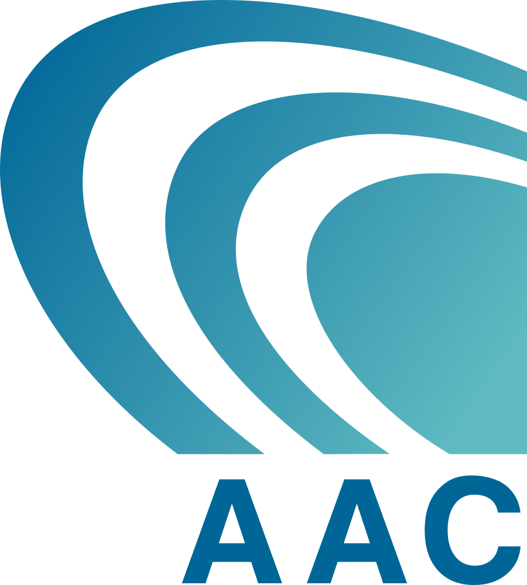
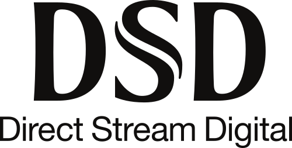
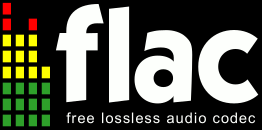
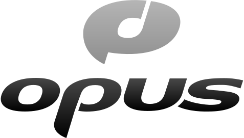
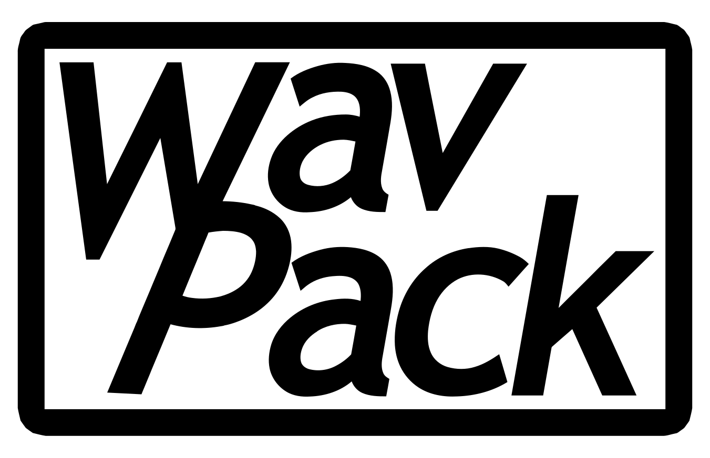
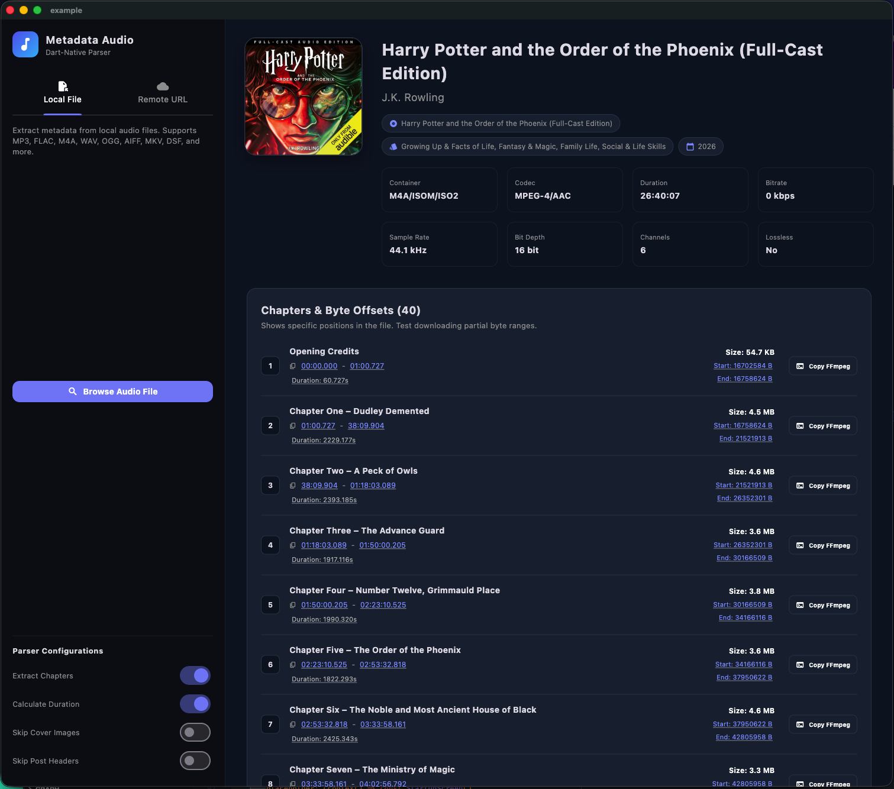
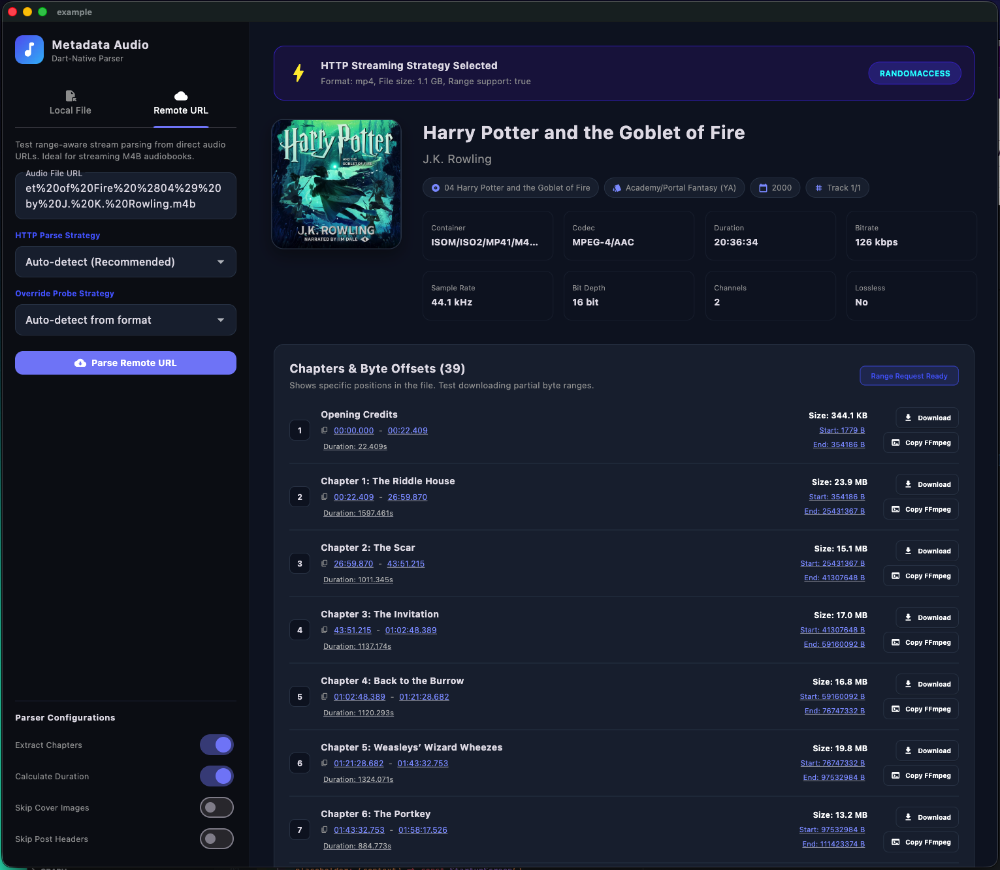

# metadata_audio

<p align="center">
  
</p>

<p align="center">
  <a href="https://pub.dev/packages/metadata_audio"></a>
  <a href="https://dart.dev"></a>
  <a href="https://audio-tag-analyzer-web.netlify.app/"></a>
  <a href="https://github.com/ketanchoyal/metadata_audio/actions"></a>
  <a href="https://codecov.io/gh/ketanchoyal/metadata_audio"></a>
  <a href="LICENSE"></a>
  <a href="https://buymeacoffee.com/ketanchoyal"></a>
</p>

---

A high-performance, pure Dart audio metadata library that provides comprehensive metadata extraction, chapter parsing, smart HTTP streaming, audiobook chapter slicing, live parsing observers, and robust resource safety guards across all major platforms (Flutter, Dart standalone, and Web).

> 🌐 **Try the Live Web Demo**: Inspect audio tags, stream properties, and embedded artwork directly in your browser with our client-side **[Audio Tag Analyzer on Netlify](https://audio-tag-analyzer-web.netlify.app/)**. 100% private — audio files never leave your computer.

## Key Highlights

- **Extensive Format Support**: Over 20 audio containers and codecs including MP3, MP4/M4A/M4B, FLAC, Ogg (Vorbis, Opus, Speex), WAV, AIFF, APE, ASF/WMA, Matroska (MKV/WebM), Musepack, WavPack, and DSD (DSF/DSDIFF).
- **Deep Tag Extraction**: Decodes ID3v1, ID3v2.2, ID3v2.3, ID3v2.4, Vorbis comments, iTunes/QuickTime MP4 atoms, APEv1/v2, ASF objects, RIFF/INFO, Broadcast Wave Format (BWF `bext` loudness), and Matroska EBML tags.
- **Embedded Chapters & Track Boundaries**: Extracts embedded chapter lists, start/end timestamps, and byte offsets from ID3v2 (`CHAP`/`CTOC`), MP4 QuickTime chapter tracks, Nero `chpl` atoms, Vorbis comments, FLAC cuesheets, WAV cue markers, and Matroska edition entries.
- **Audiobook Chapter Downloader**: Download individual chapters from local or remote audiobooks (M4B, MP4, MP3) as standalone, playable AAC/MP3 files with parallel HTTP chunk downloads.
- **Smart URL Streaming**: Parses remote audio files without downloading full files. Automatically selects between Range header-only reads (~256 KB), format-specific probing (header+tail), or random-access chunking.
- **Live Metadata Observation**: Listen to incremental metadata events (`MetadataObserver`) in real-time as frames, containers, titles, or chapters are decoded.
- **Memory Allocation & Resource Safety**: Configurable guards (`maxMemoryAllocation`, `maxMetadataEntries`, `maxChapterCount`) protect your application from malformed files and memory exhaustion attacks.
- **Zero-Memory Disk Caching**: Built-in opt-in metadata cache that writes directly to disk on IO platforms with 0 in-memory retention, paired with a bounded in-memory LRU cache on Web.
- **Pure Dart & Cross-Platform**: No native C/C++ dependencies or FFI requirements. Runs seamlessly on iOS, Android, macOS, Windows, Linux, and Web.

---

## Interactive Web Demo

Test the capabilities of `metadata_audio` live in your browser:
👉 **[audio-tag-analyzer-web.netlify.app](https://audio-tag-analyzer-web.netlify.app/)**

- **100% Client-Side & Private**: Files are parsed locally in your browser — zero audio data is ever transmitted to a server.
- **Drag & Drop Studio**: Drop your audio tracks to inspect ID3v1, ID3v2, Vorbis comments, MP4 atoms, BWF loudness info, and cuesheets.
- **Audio & Artwork Inspector**: Play audio with the built-in HTML5 player, preview embedded album art, and export the decoded structure as formatted JSON.

---

## Supported File Types

| Audio Format | Description | Icon / Logo |
| :--- | :--- | :---: |
| [AIFF / AIFF-C](https://en.wikipedia.org/wiki/Audio_Interchange_File_Format) | Audio Interchange File Format (Apple) |  |
| [AAC](https://en.wikipedia.org/wiki/Advanced_Audio_Coding) | Advanced Audio Coding / ADTS |  |
| [APE](https://en.wikipedia.org/wiki/Monkey%27s_Audio) | Monkey's Audio |  |
| [ASF](https://en.wikipedia.org/wiki/Advanced_Systems_Format) | Advanced Systems Format / WMA |  |
| [BWF](https://en.wikipedia.org/wiki/Broadcast_Wave_Format) | Broadcast Wave Format (EBU R128 Loudness) |  |
| [CAF](https://en.wikipedia.org/wiki/Core_Audio_File_Format) | Apple Core Audio Format |  |
| [DSDIFF](https://en.wikipedia.org/wiki/Direct_Stream_Digital) | Philips Direct Stream Digital (DSD) |  |
| [DSF](https://en.wikipedia.org/wiki/Direct_Stream_Digital) | Sony DSD Stream File |  |
| [FLAC](https://en.wikipedia.org/wiki/FLAC) | Free Lossless Audio Codec |  |
| [MP2](https://en.wikipedia.org/wiki/MPEG-1_Audio_Layer_II) | MPEG-1 Audio Layer II |  |
| [MP3](https://en.wikipedia.org/wiki/MP3) | MPEG-1 / MPEG-2 Audio Layer III |  |
| [MPC](https://en.wikipedia.org/wiki/Musepack) | Musepack SV7 / SV8 |  |
| [MPEG-4](https://en.wikipedia.org/wiki/MPEG-4_Part_14) | MP4, M4A, M4B, M4V, MOV |  |
| [Ogg](https://en.wikipedia.org/wiki/Ogg) | Open container format (Xiph.Org) |  |
| [Opus](https://en.wikipedia.org/wiki/Opus_(audio_format)) | Interactive audio & speech codec (in Ogg) |  |
| [Speex](https://en.wikipedia.org/wiki/Speex) | Speech codec (in Ogg) |  |
| [Theora](https://en.wikipedia.org/wiki/Theora) | Video compression (in Ogg) |  |
| [Vorbis](https://en.wikipedia.org/wiki/Vorbis) | Vorbis compression (in Ogg) |  |
| [WAV](https://en.wikipedia.org/wiki/WAV) | Waveform Audio File Format (RIFF) |  |
| [Matroska / WebM](https://en.wikipedia.org/wiki/Matroska) | Matroska (MKV, MKA), WebM (EBML) |   |
| [WavPack](https://en.wikipedia.org/wiki/WavPack) | WavPack lossless / hybrid |  |
| [WMA](https://en.wikipedia.org/wiki/Windows_Media_Audio) | Windows Media Audio (ASF) |  |

---

## Supported Tag Standards & Metadata

### Tag Formats
- **ID3**: ID3v1, ID3v1.1, ID3v2.2, ID3v2.3, ID3v2.4
- **ID3v2 Chapters 1.0**: Full `CHAP` and `CTOC` frame parsing with nested tags and sub-frames
- **iTunes / MP4**: QuickTime atoms, metadata lists (`ilst`), cover art (`covr`), freeform keys (`----`)
- **Vorbis Comment**: Ogg Vorbis, Opus, Speex, and native FLAC comment blocks
- **APEv1 & APEv2**: Monkey's Audio, WavPack, Musepack
- **ASF / WMA**: Metadata Library Objects, Extended Content Descriptions, Header Extensions
- **RIFF / INFO**: Standard WAV `INFO` chunks (`INAM`, `IART`, `IGNR`, etc.)
- **BWF**: Broadcast Wave Format `bext` chunk (EBU R128 loudness, originator, coding history)
- **Matroska / EBML**: SimpleTag, TargetTypeValue, EditionEntry chapters
- **CAF**: Apple Core Audio Format information chunks

### Lyrics Formats
- **LRC**: Formatted lyrics parsing (`[mm:ss.xx]`)
- **Synchronized Lyrics (SYLT)**: ID3v2 synchronized lyrics with millisecond timestamps
- **Unsynchronized Lyrics (USLT)**: Full language-specific lyric text extraction
- **Lyrics3**: Lyrics3v1 and Lyrics3v2 blocks

### Extended Metadata
- **ReplayGain**: Track gain, album gain, track peak, album peak
- **MusicBrainz**: Release ID, recording ID, artist ID, track ID, AcoustID (as written by Picard)
- **Multi-Track Abstraction**: `metadata.format.trackInfo` categorizes streams into `TrackType.audio`, `video`, `subtitle`, or `metadata`

---

## Screenshots

| Local File & Chapter Parsing | Remote URL Streaming & Chapter Downloads |
|:---:|:---:|
|  |  |

---

## Getting Started

### Installation

Add `metadata_audio` to your `pubspec.yaml`:

```yaml
dependencies:
  metadata_audio: ^1.0.0-beta.3
```

Or run:

```bash
dart pub add metadata_audio
```

---

## API Documentation & Usage

### 1. Parse Local Files

The library auto-initializes on first call with all format decoders registered:

```dart
import 'package:metadata_audio/metadata_audio.dart';

void main() async {
  final metadata = await parseFile('/path/to/song.mp3');

  // Common metadata (normalized across all formats)
  print('Title:       ${metadata.common.title}');
  print('Artist:      ${metadata.common.artist}');
  print('Album:       ${metadata.common.album}');
  print('Year:        ${metadata.common.year}');
  print('Genre:       ${metadata.common.genre?.join(', ')}');

  // Format properties
  print('Container:   ${metadata.format.container}');
  print('Codec:       ${metadata.format.codec}');
  print('Bitrate:     ${(metadata.format.bitrate! / 1000).round()} kbps');
  print('Duration:    ${metadata.format.duration?.toStringAsFixed(1)}s');
  print('Sample Rate: ${metadata.format.sampleRate} Hz');
  print('Channels:    ${metadata.format.numberOfChannels}');
  print('Lossless:    ${metadata.format.isLossless}');
}
```

---

### 2. Parse In-Memory Bytes (Cross-Platform & Web)

Ideal for web file pickers, network responses, or in-memory audio buffers:

```dart
import 'dart:typed_data';
import 'package:metadata_audio/metadata_audio.dart';

Future<void> handleAudioBytes(Uint8List bytes) async {
  final metadata = await parseBytes(
    bytes,
    fileInfo: const FileInfo(mimeType: 'audio/flac'),
    options: const ParseOptions(skipCovers: false),
  );

  print('Decoded title: ${metadata.common.title}');
}
```

---

### 3. Smart URL Parsing (HTTP Streaming)

`parseUrl()` inspects the remote server capabilities and file size to pick the most efficient strategy, avoiding unnecessary bandwidth usage:

```dart
import 'package:metadata_audio/metadata_audio.dart';

void main() async {
  final url = 'https://archive.org/download/sample_audio/track.m4a';

  final metadata = await parseUrl(
    url,
    options: const ParseOptions(includeChapters: true),
    timeout: const Duration(seconds: 30),
    onStrategySelected: (strategy, reason) {
      print('Selected $strategy: $reason');
    },
  );

  print('Title: ${metadata.common.title}');
  print('Duration: ${metadata.format.duration}s');
}
```

#### How URL Strategies Work:
| Strategy | Condition | Bandwidth Used | How It Works |
| :--- | :--- | :---: | :--- |
| **`fullDownload`** | File ≤ 5 MB or server has no Range support | Entire file | Downloads into memory; best for small files. |
| **`headerOnly`** | 5 MB – 50 MB (FLAC, Ogg, WAV, AIFF) | ~256 KB | Fetches the initial byte range containing all headers. |
| **`probe`** | MP3 (header+tail) or MP4 (moov probe) | ~500 KB – 1 MB | Fetches targeted chunks where headers and tables live. |
| **`randomAccess`** | Files > 50 MB (or large audiobooks) | As needed | On-demand chunk streaming with internal LRU cache. |

You can also force a specific strategy or probe beforehand:

```dart
// Pre-inspect URL without parsing
final info = await detectStrategy('https://example.com/audio.mp3');
print('File size: ${info.fileSize}, Supports Range: ${info.supportsRange}');

// Explicit strategy override
final metadata = await parseUrl(
  'https://example.com/large.mp4',
  strategy: ParseStrategy.randomAccess,
);
```

---

### 4. Chapter Extraction & Timestamp Alignment

Extract embedded chapters from audiobooks, DJ sets, podcasts, and live concert recordings:

```dart
import 'package:metadata_audio/metadata_audio.dart';

void main() async {
  final metadata = await parseFile(
    '/path/to/audiobook.m4b',
    options: const ParseOptions(includeChapters: true),
  );

  final chapters = metadata.format.chapters;
  if (chapters != null && chapters.isNotEmpty) {
    print('Found ${chapters.length} chapters:');
    for (final chapter in chapters) {
      final startSec = chapter.start / 1000;
      final endSec = chapter.end != null ? chapter.end! / 1000 : null;
      print('• [${startSec.toStringAsFixed(1)}s - ${endSec?.toStringAsFixed(1)}s] ${chapter.title}');
      if (chapter.byteOffset != null) {
        print('  Offset: bytes ${chapter.byteOffset}..${chapter.endByteOffset}');
      }
    }
  }
}
```

---

### 5. Audiobook Chapter Downloader

Extract and slice individual chapters from audiobooks directly into playable, standalone `.m4a` or `.mp3` files (fully playable on iOS AVPlayer, Android ExoPlayer, and web):

```dart
import 'package:metadata_audio/metadata_audio.dart';

Future<void> downloadChapterExample(Chapter chapter) async {
  final result = await ChapterDownloader.downloadChapter(
    originalUrl: 'https://example.com/audiobook.m4b',
    chapterStartMs: chapter.start,
    chapterEndMs: chapter.end!,
    outputPath: '/path/to/extracted_chapter_1.m4a',
    parallelChunks: 4, // 4 concurrent HTTP connections for fast download
    onPhase: (phase) {
      // connecting -> analyzing -> resolvingSamples -> downloading -> writing
      print('Current phase: $phase');
    },
    onProgress: (progress) {
      print('Progress: ${(progress * 100).toStringAsFixed(1)}%');
    },
  );

  if (result.isSuccess) {
    print('Chapter saved to: ${result.outputPath}');
  } else {
    print('Download failed: ${result.error}');
  }
}
```

---

### 6. Live Incremental Metadata Observation

Monitor metadata discoveries in real time while parsing is underway:

```dart
import 'package:metadata_audio/metadata_audio.dart';

void main() async {
  await parseFile(
    '/path/to/huge_file.m4b',
    options: ParseOptions(
      includeChapters: true,
      observer: (event) {
        final tag = event.tag;
        if (tag != null) {
          if (tag.id == MetadataCommonId.title) {
            print('Found Title: ${tag.value}');
          } else if (tag.id == MetadataFormatId.chapters) {
            final list = tag.value as List<Chapter>;
            print('Discovered ${list.length} chapters so far');
          }
        }
      },
    ),
  );
}
```

---

### 7. Resource & Allocation Safety (`ParseOptions`)

`metadata_audio` includes defensive guards to prevent hostile or malformed media files from causing memory spikes or Denial of Service:

```dart
final metadata = await parseFile(
  '/path/to/untrusted_input.mp3',
  options: const ParseOptions(
    // Maximum bytes for a single metadata block, atom, or tag (default: 64 MiB)
    maxMemoryAllocation: 32 * 1024 * 1024,

    // Maximum items decoded in a single tag list or table (default: 100,000)
    maxMetadataEntries: 50000,

    // Maximum chapters extracted from chapter tables (default: 1,000)
    maxChapterCount: 500,

    // Skip embedded artwork to conserve memory
    skipCovers: true,

    // Ignore trailer/post-headers for faster streaming
    skipPostHeaders: true,

    // Allow full scan for exact duration if header bitrate is VBR/absent
    duration: true,
  ),
);
```

> [!NOTE]
> `maxMemoryAllocation` bounds memory allocated for **metadata** structures and single-read buffer operations. Media/audio data (`mdat`, `data`, `SSND`) that is skipped does not count against this limit. Oversized payloads throw a `BufferSizeError` or format-specific content error.

---

### 8. Metadata Caching (Disk & Web)

Avoid re-parsing unchanged files or remote URLs with disk-backed (IO) and in-memory (Web) caching:

```dart
// Enable caching globally across all parseFile / parseUrl / parseBytes calls:
cacheEnabled = true; // or AudioMetadataCache.enabled = true

// First run: parses without chapters and caches under the URL/path key
final initial = await parseUrl(
  'https://example.com/audiobook.m4b',
  options: const ParseOptions(includeChapters: false),
);

// Second run on the same URL with chapters enabled:
// reuses the cached metadata and fetches only what is needed for chapters!
final withChapters = await parseUrl(
  'https://example.com/audiobook.m4b',
  options: const ParseOptions(includeChapters: true),
);

// Or opt in per call / supply your own cache key:
final metadata = await parseFile(
  '/path/to/music.flac',
  options: const ParseOptions(useCache: true),
);
final metadata2 = await parseFile(
  '/path/to/music.flac',
  options: const ParseOptions(cacheKey: 'user-audio-12345'),
);
```

- **IO Platforms (macOS, Windows, Linux, Android, iOS)**: Metadata is cached directly to local temporary storage with zero in-memory retention.
- **Web**: Automatically switches to an in-memory LRU cache bounded by `maxMemoryCacheEntries`.
- **Incremental `ParseOptions` Reuse**: Cache keys use only the source URL/path (or custom `cacheKey`), so enabling additional `ParseOptions` (`includeChapters`, `skipCovers: false`, `skipPostHeaders: false`, `duration`, `maxChapterCount`, etc.) on a subsequent run reuses cached metadata and fetches only the newly requested parts.
- **Programmatic Control**: Use `AudioMetadataCache.evict(key)` or `AudioMetadataCache.clearCache()` to manage cached entries.

---

### 9. Utility Helpers

```dart
import 'package:metadata_audio/metadata_audio.dart';

// Select primary front cover artwork:
final cover = selectCover(metadata.common.picture);
if (cover != null) {
  print('Cover MIME: ${cover.format}, Data size: ${cover.data.length} bytes');
}

// Convert normalized rating (0.0 - 1.0) to star rating (0 - 5):
final stars = ratingToStars(metadata.common.rating); // e.g. 4.5

// Order native tags into map of lists:
final id3Tags = orderTags(metadata.native['ID3v2.3'] ?? []);

// JSON serialization for storage, state management, or IPC:
final jsonString = audioMetadataToJson(metadata);
final restored = audioMetadataFromJson(jsonString);
```

---

## Error Handling

`metadata_audio` provides structured exception hierarchies so applications can gracefully handle file or network issues:

```dart
try {
  final metadata = await parseFile('corrupted.mp3');
} on CouldNotDetermineFileTypeError catch (e) {
  print('Unknown audio format: ${e.message}');
} on UnsupportedFileTypeError catch (e) {
  print('File type not supported: ${e.message}');
} on UnexpectedFileContentError catch (e) {
  print('Malformed tag/content: ${e.message}');
} on BufferSizeError catch (e) {
  print('Exceeded memory limit: requested ${e.requestedSize} > max ${e.maxBufferSize}');
} on NotRegularFileError catch (e) {
  print('Cannot parse directory or socket: ${e.message}');
} on TokenizerException catch (e) {
  print('Tokenizer failure: ${e.message}');
} catch (e) {
  print('General failure: $e');
}
```

---

## Architecture & Design

`metadata_audio` is structured into clean modular layers:

- **Tokenizers (`Tokenizer`)**: Low-level stream readers that abstract byte arrays (`BytesTokenizer`), random-access files (`FileTokenizer`), and chunked HTTP range connections (`HttpTokenizer`, `RangeTokenizer`, `ProbingRangeTokenizer`, `RandomAccessTokenizer`).
- **Parsers (`Parser`)**: Dedicated format decoders for each container/codec (e.g. `Id3v2Parser`, `Mp4Parser`, `FlacParser`, `WaveParser`, `OggParser`).
- **Tag Mappers (`GenericTagMapper`)**: Normalizes native container tags into unified, high-level `CommonTags` (title, artist, album, genre, year, disk, track, replayGain, pictures).
- **Collector (`MetadataCollector`)**: Aggregates native tags, format properties, chapters, quality warnings, and triggers observer events.

---

## Contributing

Contributions, issues, and feature requests are welcome!
See [CONTRIBUTING.md](CONTRIBUTING.md) for local development setup, guidelines, and testing instructions.

```bash
# Run tests
dart test

# Run analysis
dart analyze
```

---

## License

This project is licensed under the [MIT License](LICENSE).
